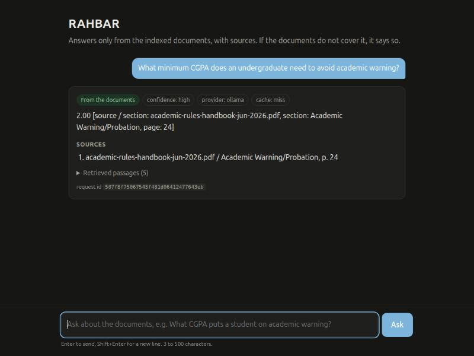
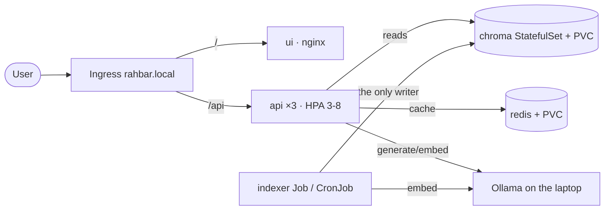

# RAHBAR: grounded answers about FAST-NUCES rules, on Kubernetes

[](https://github.com/sultan101004/rahbar/actions/workflows/ci.yml)
[](https://github.com/sultan101004/rahbar/actions/workflows/cd.yml)

A 5th-semester student wants to know whether they can register for a course after failing its
prerequisite, how long they have to withdraw, or what CGPA keeps them off academic warning. The
answers exist in FAST-NUCES PDFs, but an older 2023 version of the same rules is still online, one
of the PDFs is a scan with no text layer, and a general-purpose chatbot answers fluently about some
other university. **RAHBAR** answers only from the university's own documents, cites the clause it
used, prefers the current version, and says "the documents do not cover this" instead of
inventing an answer. It runs on Kubernetes: an indexer Job builds the vector index, and a
3-replica API reads it.



## Architecture



More in [docs/ARCHITECTURE.md](docs/ARCHITECTURE.md). The central decision, that indexing is a
Job and the API only reads, is [ADR 0001](docs/adr/0001-indexer-as-job.md).

## From a clean clone to an answered question

Prerequisites: Docker, minikube, kubectl, Python 3.12, `make`, and Ollama on the laptop.
Docker needs about 6 GB of memory; in Docker Desktop, set Settings → Resources → Memory.

```bash
git clone https://github.com/sultan101004/rahbar.git rahbar && cd rahbar
make install                                  # .venv with api, indexer and dev dependencies

# 1. Ollama on the laptop, listening on all interfaces (the cluster reaches it)
OLLAMA_HOST=0.0.0.0 ollama serve &            # leave running
ollama pull llama3.2:3b
ollama pull nomic-embed-text

# 2. The corpus: public FAST-NUCES documents, fetched, never committed
make fetch                                    # corpus/raw/ + MANIFEST.md checksums
python corpus/fetch.py --verify

# 3. Cluster with Calico (so NetworkPolicy is enforced), metrics-server and ingress
make cluster
# check the host IP the NetworkPolicy allows (default 192.168.49.1):
minikube ssh "grep host.minikube.internal /etc/hosts"

# 4. Images, built locally and loaded into minikube
make images

# 5. Apply, in this order (kustomize puts the Namespace first)
kubectl apply -k k8s/overlays/dev
# only for LLM_PROVIDER=hosted:  export LLM_API_KEY=...; make secret

# 6. Put the documents on the corpus PVC; the indexer Job is waiting for them
make corpus-load
kubectl wait --for=condition=complete job/indexer -n rahbar --timeout=30m
kubectl logs job/indexer -n rahbar | tail -3

# 7. The api pods become READY once the index exists and the embedding pin matches
kubectl rollout status deployment/api -n rahbar
echo "$(minikube ip) rahbar.local" | sudo tee -a /etc/hosts
make ask Q="What minimum CGPA does an undergraduate need to avoid academic warning?"
make ask Q="How do I apply for a hostel room?"     # declines: not in the corpus
kubectl delete pod -n rahbar -l app=api --wait=false && make ask Q="What is the deadline to withdraw from a course?"
```

`make up` runs steps 3 to 7 in one go. Open `http://rahbar.local` for the chat UI.

**Re-index with no redeploy:** `kubectl create job --from=cronjob/reindex manual-reindex-1 -n rahbar`.
The new index is built beside the live one and swapped in; the semantic cache follows the new
`index_id`.

## API

| Method | Path | Purpose |
| --- | --- | --- |
| POST | `/api/ask` | `{"question": "..."}` (3-500 chars) → answer, citations, `answered_from_context`, confidence, retrieved passages with scores; `X-Request-ID` echoed, `X-Cache: HIT/MISS` |
| GET | `/healthz` | Liveness: the process is alive. Touches nothing else. |
| GET | `/readyz` | Readiness: Chroma reachable, collection non-empty, embedding model matches `EMBED_MODEL`, Redis reachable; 503 naming the failed check otherwise |
| GET | `/metrics` | Prometheus: requests, latency, retrieval and generation latency, cache hits, abstentions, fallbacks, tokens in/out |

## Results (golden set, 21 questions, `eval/results.json`)

Measured on 8 Nov 2026 against the local stack (llama3.2:3b on CPU, nomic-embed-text, top_k 5, floor 0.70):

| Metric | Value |
| --- | --- |
| recall@3 / recall@5 | 0.9412 / 1.0 |
| recall@5 by type | ordinary 1.0 · version 1.0 · exact 1.0 · injection 1.0 |
| citation validity | 100% (13 citations) |
| abstention correctness (must-abstain) | 100% |
| answered, of answerable questions | 71% (declined: q02, q06, q11, q14, q20) |
| answer contains the expected fact | 62% |

Retrieval is solid; the small local model was the weak stage (it sometimes declined when the
evidence was there). The same pipeline with a hosted model, `LLM_PROVIDER=hosted` on Groq's
free tier (`openai/gpt-oss-120b`), answered **17/17** answerable questions in 1-2 s, all correct by
manual review, with 100% citation validity and 100% abstention (`eval/results-hosted.json`,
`eval/MANUAL-REVIEW.md`). Greetings and content-free inputs ("hey", "what?") get a usage hint
instead of a search (`api/app/services/smalltalk.py`).

The CI gate (`eval/run_eval.py`) fails the build when recall@5 drops more than 5 points below
`eval/baseline.json`, when any must-abstain question is answered, or when citation validity is
below 95%. In CI it runs against a kind cluster with the fixture corpus.

## Repository

| Path | What |
| --- | --- |
| `api/` | FastAPI service: retrieval, cache, grounding, providers (`stub`, `ollama-*`, `hosted`) |
| `indexer/` | The Job image: extract (OCR), clean, chunk, embed, store |
| `ui/` | nginx serving the chat page |
| `k8s/base`, `k8s/overlays/{dev,prod,ci}` | Kustomize manifests; `k8s/tools/corpus-loader.yaml` |
| `corpus/` | `sources.yaml`, `fetch.py`, `MANIFEST.md` (URLs + SHA-256), never the PDFs |
| `eval/` | `golden.yaml`, `run_eval.py`, `tune_retrieval.py`, `baseline.json`, `results.json`, `fixtures/` |
| `docs/` | CORPUS, PIPELINE, FAILURE-ANALYSIS, ENGINEERING-NOTES, ARCHITECTURE, AI-USAGE, ADRs, evidence |
| `.github/workflows/` | `ci.yml` (lint, test, kubeconform, build, trivy, e2e-eval), `cd.yml` (test, build-push by SHA, deploy) |

**Secrets:** none in Git. `*secret*.yaml` is gitignored, `k8s/base/secret.placeholder.yaml` holds
`REPLACE_ME` and is not in the kustomization, and the real Secret is created with
`kubectl create secret generic rahbar-secret -n rahbar --from-literal=LLM_API_KEY="$LLM_API_KEY"`.
Base64 is encoding, not encryption.

**Images:** CD publishes to the GitHub Container Registry, tagged by commit SHA
(`ghcr.io/sultan101004/rahbar-{api,ui,indexer}:<sha>`). It authenticates with the run's
short-lived `GITHUB_TOKEN`, so no registry password is stored anywhere. The handout asks for
Docker Hub; we could not use a Docker Hub account in time. Switching is one variable
(`REGISTRY: docker.io`) plus a `DOCKERHUB_USERNAME`/`DOCKERHUB_TOKEN` secret pair (an access
token, never the password) in `.github/workflows/cd.yml`.

**Corpus:** we commit `corpus/MANIFEST.md` with each URL and SHA-256 plus `corpus/fetch.py`, not
the documents. See [docs/CORPUS.md](docs/CORPUS.md).

**AI use** is disclosed in [docs/AI-USAGE.md](docs/AI-USAGE.md). Embeddings are served by the same
Ollama host as generation (`nomic-embed-text`), pinned in the ConfigMap.
