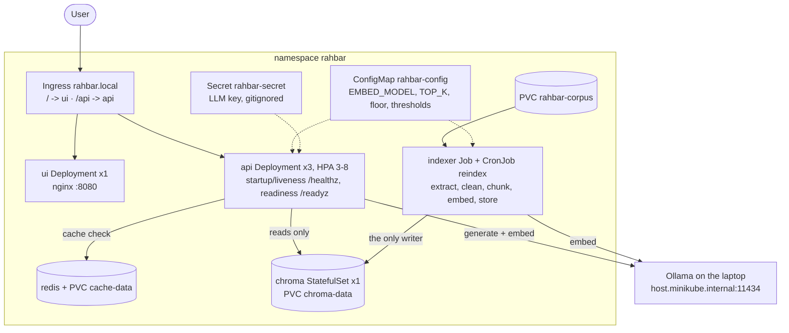

# Architecture

## Why Chroma is a StatefulSet, not a Deployment

Chroma is a database with its data on disk.

- **Stable identity and storage.** A StatefulSet gives `chroma-0` its own PVC
  (`chroma-data-chroma-0`) through `volumeClaimTemplates`. When the pod is deleted or rescheduled,
  the replacement re-attaches the *same* claim and the index survives. A Deployment with a
  shared PVC works only by accident.
- **One writer at a time.** A Deployment's rolling update starts the new pod *before* stopping
  the old one (`maxSurge`). With a ReadWriteOnce volume that either deadlocks the rollout, with
  the new pod stuck in ContainerCreating, or, on a single node, runs two Chroma processes on one
  data directory. A StatefulSet stops `chroma-0` before starting its replacement.
- **Predictable network identity.** The `chroma-headless` Service gives `chroma-0` a stable DNS
  name. The `chroma` ClusterIP Service is what the api and indexer use.

Redis also holds state but is a cache we can lose, so a Deployment with `strategy: Recreate` and
a PVC is enough.

## The two paths

| Path | Runs | Process | Reads | Writes |
| --- | --- | --- | --- | --- |
| Indexing | once, again when material changes | `indexer` Job / CronJob | corpus PVC, Ollama embeddings | Chroma (build-then-swap) |
| Querying | every question | `api` Deployment | Chroma, Redis, Ollama | Redis cache only |

## Security summary (section 4.7)

| Hole | Closure here |
| --- | --- |
| Secrets in Git | `*secret*.yaml` gitignored. Only `k8s/base/secret.placeholder.yaml` (REPLACE_ME, not in kustomization) is committed; the Secret is created with `kubectl create secret`. |
| Everything is admin | One ServiceAccount per workload, `automountServiceAccountToken: false` on all of them; none calls the API server. |
| Containers as root | `runAsNonRoot: true`, `readOnlyRootFilesystem: true`, `capabilities: drop: [ALL]`, `allowPrivilegeEscalation: false`, seccomp RuntimeDefault on every container. One documented exception: the `fix-permissions` init containers of chroma and redis run as root with only `CAP_CHOWN` to chown their PVC, because the kind/minikube provisioners ignore `fsGroup` (found when CI crashed chroma with `unable to open database file`). |
| Flat network | `default-deny-all`, then ui from ingress-nginx; api from ingress-nginx and ui; chroma from api and indexer; redis from api; DNS for all. The ui pod cannot reach chroma. Needs `--cni=calico`. |
| Unsafe model output | Schema-constrained, Pydantic-validated, citations checked against retrieved chunks; never passed to `eval`, never used to build SQL. |
